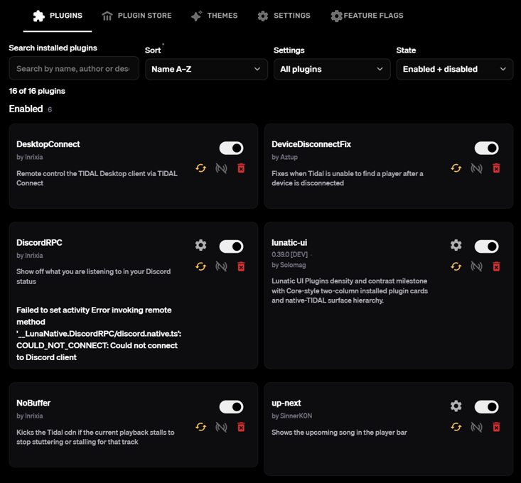
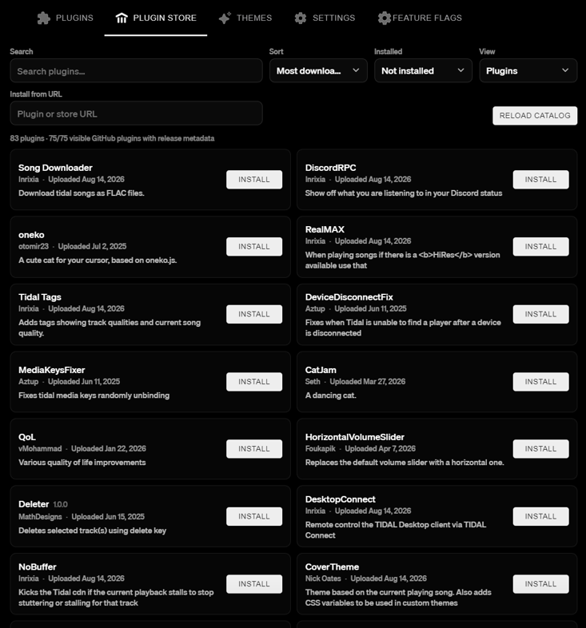

# Lunatic

A TIDAL-native settings UI and appearance editor for **[TidaLuna](https://github.com/Inrixia/TidaLuna)** and **[TidaLunar](https://github.com/Brskt/TidaLuna)**.

Most people who run Luna are not developers: the settings page is the only part of it they ever see. Lunatic makes that page look like it belongs in TIDAL and makes it easy to find, understand and manage plugins.

| Installed plugins | Plugin store |
| --- | --- |
|  |  |

## Plugins

| Plugin | What it does |
| --- | --- |
| **Lunatic UI** (`@solomag/lunatic-ui`) | Rebuilds the Luna Settings page: installed plugins grouped into *Failed to load / Enabled / Disabled* with search and filters, a cached plugin store with search, opt-in download counts and preview images, themes, settings and a separate Feature Flags tab. Colours come from TIDAL's own `--wave-*` design tokens and icons from TIDAL's own sprite. Also adds a confirmation before Log Out and keeps settings pages clear of the player bar. |
| **Lunatic Appearance** (`@solomag/lunatic-appearance`) | Colour editor (HSV + alpha, live preview, save/discard/reset) for the settings page; optionally pushes its colours into a theme palette (`--solo-*`) so a theme that publishes it into TIDAL's tokens recolours all of TIDAL. |
| **Copy Artist - Title** (`@solomag/copy-artist-title`) | Adds *Copy Artist - Title* to the track, album and playlist context menu: copies one `Artist - Title` line per track to the clipboard, with several artists joined by `, `. |
| **Lunatic Shortcuts** (`@solomag/lunatic-shortcuts`) | Extra keyboard shortcuts: volume, mute, repeat, like the playing track, go to the playing artist or album. Rebind or turn them off in Luna Settings (needs Luna with the `Shortcut` API). |
| **Custom Covers** (`@solomag/custom-covers`) | Right click an album or playlist → *Set custom cover…* to show your own cover instead of TIDAL's, from an image link or a local file (scaled to 1280px and kept in plugin storage). It shows everywhere the cover does: headers, grids, the player bar, now playing and the OS media controls. Only changed locally; *Reset custom cover* or the plugin settings bring TIDAL's cover back. |
| **Scroll Restore** (`@solomag/scroll-restore`) | Remembers how far you scrolled on each page (collection tabs, playlists, albums, artists, search) and returns you there when you open it again from the sidebar, a tab or a link. Long lists are loaded until the position is reached; scrolling yourself stops it. |
| **Remote API** (`@solomag/remote-api`) | A local HTTP and WebSocket API to control TIDAL from other apps: play, pause, skip, seek, volume, add a track to the queue, and read the current track and player state. For stream bots (streamer.bot), Stream Deck and scripts. Only this computer by default, optional token. Based on [`@vmohammad/api`](https://github.com/vMohammad24/luna-plugins/tree/master/plugins/api) by vMohammad. |

Each plugin works on its own.

## Install

In Luna: **Settings → Plugin Store → Install from URL**, paste

```
https://github.com/Solomag/lunatic-ui/releases/download/latest/store.json
```

and install the plugins you want from the new store.

### Works best with the Luna core extensions

Lunatic runs on stock TidaLuna and TidaLunar. On a stock build it rebuilds the settings page by patching it (with a DOM fallback if that fails). On a Luna build with these small core extensions it uses proper APIs instead and needs no patching:

| Extension | TidaLuna branch | TidaLunar branch |
| --- | --- | --- |
| `SettingsTabs` API: plugins add/override settings tabs | [`feat/settings-tab-api`](https://github.com/Solomag/TidaLuna/tree/feat/settings-tab-api) | [`lunar/settings-tab-api`](https://github.com/Solomag/TidaLuna/tree/lunar/settings-tab-api) |
| Store list from `store/stores.json` (Inrixia/TidaLuna#195) | [`feat/store-list`](https://github.com/Solomag/TidaLuna/tree/feat/store-list) | [`lunar/store-list`](https://github.com/Solomag/TidaLuna/tree/lunar/store-list) |
| Plugin errors attributed to the right plugin (from #197) | [`feat/plugin-error-attribution`](https://github.com/Solomag/TidaLuna/tree/feat/plugin-error-attribution) | [`lunar/plugin-error-attribution`](https://github.com/Solomag/TidaLuna/tree/lunar/plugin-error-attribution) |
| Plugin reload order fix (Inrixia/TidaLuna#196) | [`fix/lib-reload-order`](https://github.com/Solomag/TidaLuna/tree/fix/lib-reload-order) | [`lunar/lib-reload-order`](https://github.com/Solomag/TidaLuna/tree/lunar/lib-reload-order) |

## Develop

```bash
pnpm install
pnpm watch      # builds into dist/ and serves it on http://127.0.0.1:3000 (Luna lists it as [DEV])
pnpm typecheck  # fails on type errors in plugins/
pnpm build
```

Releases: push a `v*` tag (or run the *Release* workflow) to publish `dist/` as the `latest` GitHub release.


## Credits

- **FlazeIGuess** — the TIDAL design tokens and sprite icons approach, state grouping, preview images, opt-in download counts and the store registry, from Inrixia/TidaLuna#195 and #197 (MS-PL).
- **Inrixia** and contributors — TidaLuna and the plugin template this started from; **Brskt** — TidaLunar.

## License

MIT, see [`LICENSE`](LICENSE). Third-party parts keep their own licenses, see [`THIRD_PARTY_NOTICES.md`](THIRD_PARTY_NOTICES.md).
